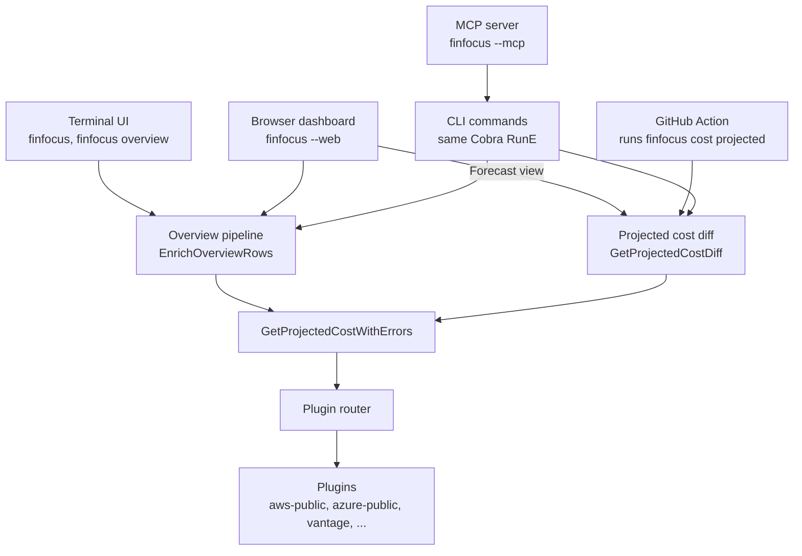

FinFocus has four ways in: the terminal UI, the browser dashboard (`finfocus --web`), the
[GitHub Action](https://github.com/rshade/finfocus-action), and the MCP server for AI agents (`finfocus --mcp`).
They are not four products that happen to agree. Each one is a thin layer over the same Go engine, and every
resource price comes from the same engine call through the same plugin. This page explains where the surfaces meet,
what each one owns, and what that means for users, plugin authors, and contributors.

## Where the surfaces meet

Every path ends at `(*Engine).GetProjectedCostWithErrors` in `internal/engine/engine.go`, which hands each
resource to the plugin router. The router picks the plugin by your routing configuration, the same way for every
surface. A resource that one surface prices with `aws-public` gets the same price from the same plugin on every
other surface, for the same input.

Above that call there are two routes in:

| Surface | How it reaches the engine |
| --- | --- |
| Terminal UI | `newOverviewPipeline` in `internal/cli/overview_pipeline.go`, then `engine.EnrichOverviewRows`, which adds projected cost, actual cost, recommendations, and drift to each row |
| Browser dashboard | The same `newOverviewPipeline`, built in `internal/cli/web_stack.go`. The Forecast view prices the stack with `GetProjectedCostDiff` |
| GitHub Action | Runs `finfocus cost projected --output json`, which calls `GetProjectedCostDiff` in `internal/engine/diff.go`. That handles replacements and before-and-after pricing, then calls `GetProjectedCostWithErrors` |
| MCP server | Each MCP tool is a CLI command. Calling the `finfocus-cost-projected` tool runs the same code as typing `finfocus cost projected` |

The terminal UI and the browser dashboard share the most: the same seven-phase overview pipeline, and the same
filtering, sorting, grouping, and money formatting in `internal/engine` and `internal/viewmodel`. See
[Web UI Design](web-ui.md) for how the dashboard keeps that rule. The Action and the MCP server join through
the CLI commands, so they share the engine and plugins without the interactive views.

## What each surface owns

A surface owns only how it takes input and how it shows the result:

- **Terminal UI:** the interactive views, key bindings, and terminal capability detection.
- **Browser dashboard:** the local HTTP server, its session and security model, and the page rendering. The browser
  computes nothing; it displays what the engine returned.
- **GitHub Action:** the TypeScript in `finfocus-action` that installs FinFocus and plugins, runs the CLI, reads its
  JSON output, and writes the pull request comment.
- **MCP server:** the tool list and the transport: stdio for `finfocus --mcp`, or streamable HTTP on loopback with
  `finfocus mcp-server --transport=http`. The server comes from
  [ax-go](https://github.com/rshade/ax-go), which turns the command tree into MCP tools. Commands that cannot run
  inside a tool call are left out of the tool list: the interactive dashboard, `analyzer serve`,
  `cost history collect`, `cost history collect-daily`, `setup`, `plugin init`, and `plugin upgrade`. The list,
  with the reason for each, is `mcpExcludedCommands` in `internal/cli/mcp.go`.

## What this means for you

- **Users** can move between surfaces without re-checking numbers. A cost you explore in the terminal matches what
  the dashboard shows for the same input. The Action's comment prices each resource with the same engine call and
  plugin as the terminal UI.
- **Agents** get the same answers people get. An agent that calls the estimate, recommendations, or anomalies tools
  before suggesting a change sees the numbers the CLI would show. To connect an agent, see the
  [MCP guide](../guides/mcp.md).
- **Plugin authors** implement the [plugin protocol](plugin-protocol.md) once. Every surface reaches the plugin
  through the same router, so there is no per-surface integration.
- **Contributors** fix a pricing or calculation bug once, in `internal/engine`, and every surface gets the fix.
  New cost behavior belongs in the engine, not in a surface. A surface that computes its own numbers would break
  the agreement this page describes.

## Related pages

- [System Overview](system-overview.md) describes the components under the engine: ingest, plugin host, and
  registry.
- [Web UI Design](web-ui.md) explains how the browser dashboard shares the engine.
- [Cost Calculation](cost-calculation.md) covers the projected and actual cost formulas.
