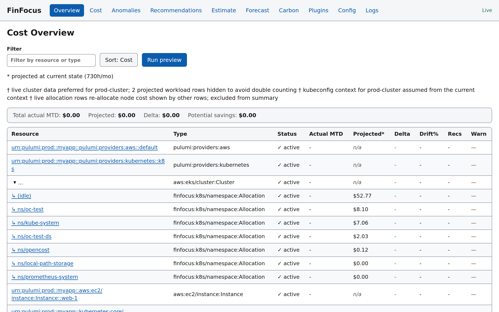

Reference for the browser dashboard that `finfocus --web` serves. For
step-by-step tasks, see [Use the browser dashboard](../guides/web-ui.md). For
the reasoning behind the security model, see
[Web UI design](../architecture/web-ui.md).

## Launch

```bash
finfocus --web [--port N] [--no-browser] [--pulumi-json FILE] [--pulumi-state FILE]
               [--stack NAME[,NAME]...] [--from DATE] [--to DATE] [--adapter NAME] [--filter EXPR]...
               [--allowed-host NAME]... [--trusted-proxy --allowed-user LOGIN...]
```

- `--web` and its companion flags are root-local: they exist only on the root
  `finfocus` command and no subcommand inherits them.
- Every companion flag requires `--web`. `--web` and `--mcp` can't be combined.
- With no source flag, the Pulumi project, stack, and state are detected from
  the working directory, as for `finfocus overview`.
- `--terraform-state` isn't accepted.
- `--stack` takes one name, or a list for several tabs: `--stack dev,prod` and
  `--stack dev --stack prod` are the same. Surrounding whitespace is trimmed,
  repeated names count once, and the first name is the first tab. A list of two
  or more names must be stacks of the Pulumi project in the working directory,
  and can't be combined with `--pulumi-json` or `--pulumi-state`. One name, or
  none in a Pulumi project, is the single-stack page: one tab names that stack
  (the workspace's selected stack when `--stack` is absent) and addresses stay
  `#/<view>`. `--pulumi-json`, `--pulumi-state`, and Terraform show no tab bar.
- `--allowed-host`, `--trusted-proxy`, and `--allowed-user` serve the dashboard
  behind an HTTPS proxy on the same machine. See
  [Serve behind a proxy](../guides/web-ui.md#serve-behind-a-proxy).

The flag table, with defaults, is in the
[CLI Commands Reference](cli-commands.md#options-web).

## Output

| Stream | Content |
| --- | --- |
| stdout | One line: the session URL, `http://127.0.0.1:<port>/?token=<token>`. The token is 128 random bits as 32 hex characters. With `--trusted-proxy`, a second line holds `https://<first allowed host>/`. |
| stderr | With `--trusted-proxy`, a warning that any local process can forge the identity header. Diagnostics and one request log line per request that passes the `Host` check: method, path without the query string, and status. Tokens and request bodies are never logged. |

Unless `--no-browser` is set, FinFocus opens the URL with the platform opener
(`open` on macOS, `rundll32` on Windows, `xdg-open` elsewhere). A failure to
start the opener is logged as a warning. The server keeps running.

## Exit codes

| Code | Meaning |
| --- | --- |
| 0 | The server shut down cleanly after `Ctrl+C`. |
| 1 | Launch failure: no Pulumi project found, port unavailable or outside 0-65535, unknown flag (including `--web` on a subcommand). |
| 2 | Invalid input: a companion flag without `--web`, `--web` with `--mcp`, an unparsable `--from`/`--to`, or a bad stack list (an empty or invalid name, a name the project doesn't have, or a list with `--pulumi-json`, `--pulumi-state`, or a Terraform project). The message for an unknown name lists the project's stacks. |

## Views

The header links to nine views, and a tenth, Logs, when you turn it on. Each has its own URL fragment, and a
**Skip to main content** link comes first in the tab order.

| View | Fragment | Shows |
| --- | --- | --- |
| Overview | `#/overview` | Loading checklist. Resource table (Resource, Type, Status, Actual MTD, Projected, Delta, Drift%, Recs, Warn). Totals, budget health, and resource details. |
| Cost | `#/cost` | Actual costs, summary with provider shares and carbon equivalencies when plugins supply them, trends when history is available |
| Anomalies | `#/anomalies` | Resources whose month-to-date run-rate has diverged from the projected month: resource, type, period, baseline, observed, deviation, drift %, and currency, with the count of resources considered |
| Recommendations | `#/recommendations` | Recommendation counts, savings, actions, descriptions, and scorer signals when scoring is configured |
| Estimate | `#/estimate` | What-if comparison for one resource: baseline, modified monthly cost, total change, and per-property deltas |
| Forecast | `#/forecast` | Monthly cost projected from the current month, with the growth model or a statistical model fitted to a spend CSV, its bounds, the plan baseline, budget, and warnings |
| Carbon | `#/carbon` | Provider-published monthly carbon emissions for complete UTC months, with source, provider, grouping, period, model version, and retrieval time per record |
| Config | `#/config` | Effective configuration, the tier each value comes from, and edits to known settings in the project or global file |
| Plugins | `#/plugins` | Catalog and custom registries, installed versions, release operations, and per-plugin settings |
| Logs | `#/logs` | Live log lines from FinFocus and its plugins. Shown only when [web logs are enabled](#logs-view). |

### Overview controls

| Control | Effect |
| --- | --- |
| Filter | Filters resources by name or type. `Escape` in the box clears it. |
| **Sort** | Cycles the sort field: Cost, Name, Type, Delta. |
| **Run preview** | Runs `pulumi preview` on demand and applies pending changes. One preview runs at a time. Elapsed time is shown while it runs. |
| Cluster expand/collapse | Expands or collapses a Kubernetes cluster row. |
| Resource row | Opens details: actual and projected breakdowns, current and after-change cost impact, cost drift, a **Declared at** row (`file:line` of the declaration, shown only when Pulumi recorded one inside the project), property changes, blast radius (dependents with count, monthly total, and what the total leaves out), recommendations, and budget status. Each blast-radius dependent opens its own detail, with a **Back to** button. |
| **Previous** / **Next** | Pages through large tables. |

When a stack mixes currencies, resource rows stay visible and the totals show
an explicit totals-unavailable message instead of a sum.

### Cost controls

| Control | Effect |
| --- | --- |
| Filter | Filters by resource or type. |
| Group by | None, Resource, Type, Provider, Daily, or Monthly. The CLI's deprecated `date` alias isn't offered. |
| Tag filter | A `key=value` tag filter, parsed as the CLI parses it. |
| Sort by | Cost, Name, Type, or Delta. For Daily and Monthly, Name becomes Period and Type and Delta are disabled. |
| Row | Opens actual-cost details, breakdown, sustainability metrics, and linked recommendations. Time-period rows have no details. |

Results are paged at 250 rows.

### Recommendations controls

Recommendations use the same live inventory as `finfocus cost recommendations`:
preview resources plus unchanged deployed resources, including preview-only
creates. A resource present in both state and preview uses the preview version.

| Control | Effect |
| --- | --- |
| Filter | Filters by resource, action, or description. |
| Sort by | Savings, Resource, or Action. |
| **Include dismissed** | Fetches dismissed recommendations too. It reads dismissal records and never changes them. |
| Row | Opens details, including every scorer signal and reasoning. |

Dismissed recommendations are hidden by default. The browser can't dismiss,
snooze, or undismiss a recommendation. Results are paged at 250 rows.

The session can return the same lifecycle events as
`finfocus cost recommendations history` for a recommendation in the most recent
list. The detail panel shows it under **Lifecycle**: time, action, actor,
reason (with the note), and expiry, in the same order as the command. A
plugin that couldn't answer adds a warning above the table. A
recommendation with no history, or with no recommendation ID, says so.

### Carbon controls

The Carbon view calls the same Go method as `finfocus carbon actual` and shows
the same report as `--output json`. It sends nothing until you press **Run
report**, because each query launches the `aws-ce` plugin and calls AWS.

| Control | Effect |
| --- | --- |
| Start, End | First-of-month UTC dates in `YYYY-MM-DD`. The end date is exclusive. |
| Accounting method, Scope | The method is market-based or location-based. The scope is total, scope 1, 2, or 3. |
| Accounts, Regions, Services | Optional comma-separated filters. |

The total is the sum of the returned available records, calculated by the
server. A record with no value shows **Missing**, which differs from an
explicit `0`. A report with no records keeps the query you ran and states that
the total is unavailable, not zero. A failed query clears earlier results and
shows a fixed message. A disabled provider names the setting that enables it.

### Anomalies

The Anomalies view calls the same Go function as `finfocus cost anomalies`
and lists the same resources in the same order, for the rows the Overview
already holds. It starts no pricing run and has no controls: the list has no
filter, sort, or run button. A status line reads `N of M resources`, or
`No anomalies found (0 of M resources).` when nothing drifted. While the
Overview is still pricing, the view shows `Waiting for stack data…` and loads
the list when the session is ready. It refreshes when the Overview does, for
example after **Run preview**. The server formats every amount, percentage, and
period. A failed request shows an alert and clears the table.

### Forecast controls

The Forecast view calls the same Go method as `finfocus cost forecast` and
shows the values of `--output json` for the same settings, with money and
month labels formatted by the server. It sends nothing until you press **Run
forecast**.

| Control | Effect |
| --- | --- |
| Months ahead | 1 to 36. The table starts at the current month. |
| Model | Plugin growth (`--model growth`) or Statistical (`--model arima`). |
| Growth type, Growth rate | The same as `--growth-type` and `--growth-rate`. |
| Growth cap, Steps | The same as `--growth-cap` and `--step`. Steps are comma-separated `DATE=AMOUNT`. |
| Spend CSV, Confidence, Exclude ranges | Shown for the statistical model. The browser reads the chosen file and sends its text. The server never opens a path from the page. Ranges are comma-separated `FROM:TO`. |
| Include cost history | Off is `--no-history`. |

For the statistical model, the table has one column per monthly series: the
forecast, its lower bound, its upper bound, and the plan baseline. For the
growth model, it has one column per provider. Stored cost history and the
spend CSV are summarized below it, with their date range. A failed query
clears earlier results and shows the message `cost forecast` prints for the
same settings.

### Cluster allocation API

`finfocus cost cluster` is reachable through the HTTP API, through the same
Go methods the command calls. The dashboard has no Cluster view yet. A
request takes `context`, `namespace`, `selector` (a list of `key=value`),
`groupBy`, `from`, `to`, `usageSource`, `allocator`, and `policy`, each in
the syntax of the flag of the same name. `policy` is the allocation policy's
HuJSON text: the server never opens a path from the page. Without it, the
project and then the global `allocation.hujson` apply, named by tier
(`project allocation.hujson`) rather than by path.

The answer is the `--output json` document plus `status` and `display`
strings. When no installed plugin provides `usage_stats` or `allocation`,
the answer is still HTTP 200, with `status: "unavailable"` and the missing
`capability`. Each plugin call keeps the command's own deadline, so a long
historical window isn't cut short.

Meanwhile, the Overview's cluster rows show the same live allocation: expand
a cluster to list its namespaces and idle capacity.



### Estimate controls

The resource picker uses the same live inventory as `finfocus cost estimate`,
including unchanged deployed resources and preview-only creates. Estimate and
Recommendations read the shared snapshot used by Overview.

| Control | Effect |
| --- | --- |
| Resource | Chooses the resource. Resources that the initial preview creates are included, also on a first deployment. |
| Pricing mode | **Automatic provider**, or a mode from a plugin's pricing spec. Choosing a mode recalculates through that plugin. |
| Current value | Edit a property value, then press `Enter` or leave the field to recalculate. Leaving a field you didn't change doesn't recalculate. |

If the baseline price fails, the property rows and pricing modes still appear,
the comparison stays empty, and the error is shown inline. Editing a value or
choosing a mode tries the price again. An unknown pricing mode is rejected
without those rows.

### Config controls

| Control | Effect |
| --- | --- |
| Edit tier | Selects the project or global `config.hujson` to edit. Project is disabled when no project directory resolves. |
| Setting editor | Changes one known setting. A secret field starts empty. Leaving it blank keeps the stored secret. |
| Remove | Drops that key from the selected tier only. |
| **Review changes** | Asks the server for a before/after preview. The preview writes nothing. |
| **Confirm** | Writes the previewed changes to the selected file. |
| **Cancel** | Closes the preview. The file is unchanged. |
| **Reload** | Reads both configuration files again. |

Secrets and notification destinations are shown as set or not set. The page
never fills a secret field from the stored value. Alert, routing, and analyzer
settings are listed and aren't editable. A successful save tells you that the
running session keeps its startup configuration.

### Plugins controls

| Control | Effect |
| --- | --- |
| **Registries** | Adds, removes, and refreshes global HTTPS registry sources. |
| Catalog row | Shows the source, name, description, providers, capabilities, security level, installed versions, and the newest catalog version. An older install is marked update-available. |
| Outside the catalog | An installed plugin that isn't a catalog entry. Validate, settings, and remove stay available. Install and update aren't offered. |
| **Install** / **Update** / **Remove** | Opens a confirmation that names the plugin, version, repository, and security level. The download or delete starts after confirmation. |
| Progress | Shows the current phase and, while downloading, bytes received and the total when the host reports one. |
| **Validate** | Checks the installed files and that the plugin process starts. A failure stays on the page with the reason. |
| Settings tier | Selects the project or global `config.hujson`, the same files as Config. |
| Setting editor | Edits one plugin setting. A secret field starts empty. Leaving it blank keeps the stored secret. When ESC supplies the effective value, the Status cell reads `from ESC (<reference>)` and the help text names that environment. The page never shows the variable's value. |
| **Review changes** / **Confirm** | Previews, then writes, through the same configuration writer as Config. |
| Save notice | Saved settings apply the next time that plugin is launched. |

The page installs catalog names only. A download URL isn't accepted. When the
newest release has no files yet, the confirmation names the older version that
will be installed. A missing checksum file is named before the install
continues, unless `FINFOCUS_SECURE_PLUGINS` is on: then the page refuses the
release and nothing is installed. A checksum that doesn't match stops the install.
Custom registries require the user to type the exact registry name on the
first install. Every release from a custom registry requires a matching
checksum, regardless of the secure plugin mode setting. Custom catalog
entries can't replace a built-in name.

### Logs view

The Logs view is off by default. When it's off, the header has no Logs link
and nothing is captured. `GET /api/logs/status` still answers `200` with
`enabled` false, so the page can hide the link without a failed request.
`GET /api/logs/stream` doesn't exist.

| Setting | Effect |
| --- | --- |
| `FINFOCUS_WEB_LOGS` | `1` or `true` turns the view on, and `0` or `false` turns it off. Any other non-empty value is a validation error (exit 2) when the dashboard starts. |
| `web.logs.enabled` | `true` turns the view on in `config.hujson`. Set it with `finfocus config set web.logs.enabled true`. |

The environment variable wins over the configuration key. With neither set,
the view is off. The setting is read when the dashboard starts, so a change
applies to the next launch. Capturing starts with the dashboard, so lines from
the initial load are already there when you open the view.

| Control | Effect |
| --- | --- |
| Source chips | One chip per source seen so far (`core` and each plugin). Select chips to show only those sources. |
| Source kind | **All sources**, **Core**, or **Plugins**. |
| Minimum level | **All levels**, or a level and above (`trace+` through `panic+`). |
| Filter | Text to find in the message and in field values. Nothing else is searched. |
| **Regex** | Reads the filter as a regular expression. An invalid expression is reported next to the box and the previous result stays. |
| **Pause** / **Resume** | Stops following the newest line. The status line counts lines that arrive while paused. |
| **Clear** | Empties the view. The server buffer isn't cleared. |
| **Download NDJSON** | Saves the rows shown, after filters, as `logs-<timestamp>.ndjson`. The browser builds the file. There is no download endpoint. |

The status line reads `Showing N of M lines`. While paused it adds
`K new lines while paused`, with the singular when the count is one. When the
view drops rows past its newest 2000, the line says how many older lines were
dropped.

Each row shows the time, a level badge that carries the level name as text, the
source, and the message. A row that has more fields is a button: Enter or
Space expands and collapses them. A row with no fields isn't a control. All
text is inserted as text, so markup in a message is shown literally.

While the view is following, new lines are announced as they arrive. While it's
paused, those lines stay quiet and the status line announces the pending
count. If the server buffer no longer has lines from before a reconnect, the
view adds a warning such as `3 log lines were dropped from the buffer`. That
count is lines the buffer already dropped, including ones noticed after a
reconnect.

The server keeps the newest 5000 entries in memory. When the buffer is full, the
oldest entry is dropped and counted. Nothing the viewer captures is written to
disk. The configured log file receives the same lines as it does when the view
is off.

Credential-like field names and Pulumi secret values in fields are replaced
with `[redacted]` before an entry leaves the server, and fields whose names
start with `__` are removed. The free-text `message` is shown as written.

A failed `pulumi preview` is logged at warn with only a short reason, such as
`loading Pulumi plan: read_failed`. Pulumi's own error output is logged at
debug, so the Logs view shows it only when the dashboard runs at debug level
(`--debug` or `FINFOCUS_LOG_LEVEL=debug`). Anyone who can open the dashboard,
including users admitted through `--trusted-proxy`, can then read it.

#### Log sources

A plugin's lines are tagged with its `plugin_name` field when the line has one.
Otherwise the tag is the plugin's name taken from its binary path, such as
`aws-public` for `finfocus-plugin-aws-public`. Lines from the host are `core`.
A line in the default text format (`logging.format: text`) is read for its
time, level, message, and fields, the same as a JSON line. Any other line that
isn't JSON is shown at level `info`, with the tag of the plugin that printed
it. A line that starts with `{` but isn't a complete JSON object, such as one
cut at 64 KiB, is replaced by a notice, because its fields can't be checked
for credentials.

While the view is on, FinFocus doesn't pass `FINFOCUS_LOG_FILE` to plugins.
Their log output goes to standard error, and FinFocus copies it to the log
file and to the view. See [Web UI design](../architecture/web-ui.md#log-capture).

The same entries are available in the terminal with
[`finfocus logs`](../commands/logs.md).

### Web-only controls

The **Group by** selector and the **Include dismissed** checkbox expose existing
CLI options that the terminal UI fixes at launch or lacks. Both go through the
same engine code path as the CLI flags.

### Stack tabs

With two or more stacks the header shows the active stack's name and a tab bar
between the title and the view links. Each tab is one stack, in the order you
gave. Every view (Overview, Cost, Recommendations, and the rest) shows only the
selected stack's data, with nothing combined across stacks. The address is
`#/s/<stack>/<view>`. An address with no stack, or an unknown one, opens the
first stack.

A stack starts loading the first time its tab is selected, so only the stacks
you open run plugins. Leaving a tab ends its live updates, and returning to it
shows what it already loaded. A tab shows its state in text and in its
accessible name. The `failed` and `locked` states also carry a warning sign:

| Marker | Meaning |
| --- | --- |
| none | Not opened yet, or ready. A stack you opened is done once its `loading` marker clears. |
| `loading` | The stack is loading or still pricing its resources. It has no warning sign. |
| `failed` | The stack couldn't load. Its view shows the same safe message a single-stack run shows. Other tabs are unaffected. A failed stack stays failed until you restart the dashboard. |
| `locked` | The stack is waiting for its passphrase. The prompt appears in that tab and unlocks only that stack. |

With one stack from a Pulumi project, the header names it and the tab bar
shows it as a single selected tab with the same `loading`, `failed`, and
`locked` markers.
Nothing else changes: the address stays `#/<view>`, and there is nothing to
switch to. A plan file, a state file, or Terraform shows no tab bar. Whether
or not there is a tab bar, a stack that's waiting for its passphrase or
failed to load says so above any view but Overview and links to Overview.

## Keyboard and display

| Input | Action |
| --- | --- |
| `Left` / `Right` on a stack tab | Select the previous or next stack, wrapping at the ends |
| `Home` / `End` on a stack tab | Select the first or last stack |
| `Tab` / `Shift+Tab` | Move between controls |
| `Enter` / `Space` | Activate the focused button |
| `Enter` in an estimate value, or `Tab` out of an edited one | Recalculate |
| `Escape` | Close the open detail panel or dialog. In the overview filter box, clear the filter |

Closing a detail view returns focus to the control that opened it. Light and
dark palettes follow the browser's `prefers-color-scheme` setting.

## HTTP behavior

The server binds `127.0.0.1` only. All responses carry
`Cache-Control: no-store`, `Referrer-Policy: no-referrer`, and
`Content-Security-Policy: default-src 'self'`. Errors are JSON:
`{"error": "<message>", "code": "<code>"}`, except that a missing file under
`/static/` gets Go's standard plain-text 404. An unknown path, or an API path
called with the wrong method, gets `404` / `not_found` (`unknown path`).

| Request | Status | Code | Message |
| --- | --- | --- | --- |
| `GET /?token=<valid>` | 303 to `/` | - | Sets the session cookie |
| `GET /?token=<wrong>` | 401 | `unauthorized` | `invalid session token; open the URL printed in the terminal` |
| Any other request without the session cookie | 401 | `unauthorized` | `valid session cookie required; open the URL printed in the terminal` |
| `Host` other than `127.0.0.1:<port>` or `localhost:<port>` | 403 | `forbidden` | `host header is not this server` |
| `Sec-Fetch-Site` present and other than `same-origin` or `none` | 403 | `forbidden` | `request is not from this server` |
| `Origin` other than the server's own | 403 | `forbidden` | `origin is not this server` |
| `POST` without `Origin` | 403 | `forbidden` | `origin header required` |
| `POST` whose `Content-Type` isn't `application/json` | 415 | `unsupported_media_type` | `Content-Type must be application/json` |
| `GET /api/overview/resource?urn=<urn>` | 200 | - | Row details, `display.declaredAt` (`file:line`, omitted when unknown) and `row.location` (`file`, `line`, optional `column`), plus `blastRadius`: `available`, `dependents` (each with `depth`, `via`, `status`, `monthlyCost`, `priced`, `component`), `count`, `monthlyTotal` (omitted when `mixedCurrency`), `currency` and `leftOut` (`deleting`, `unpriced`, `unresolved`). Check `available` first. |
| `GET /api/overview/anomalies` | 200 | - | The same list as `finfocus cost anomalies --output json`, read from the session's overview rows and the session stack's stored daily actuals with no new pricing run: `considered` and `anomalies` (`resource`, `type`, `period`, `baseline`, `observed`, `deviation`, `percentDrift`, `severity`, `method`, `currency`, and `baselineWindow` on `method: robust-median` rows). An `anomalies` item's `method` is `drift` (run-rate divergence) or `robust-median` (the most recent complete day against the median of the resource's own 14-or-more earlier days). An empty `anomalies` array with a nonzero `considered` means nothing qualified. Until enrichment finishes the answer is 503 `not_ready`. Each item also carries a `display` object (`baseline`, `observed`, `deviation`, `drift`, `period`) and the body a `summary` count line. The page shows those strings. |
| `GET /api/stacks` | 200 | - | The registered stacks in order, `{"stacks":[{"name","state"}]}`. `state` is `idle`, `loading`, `locked`, `ready`, or `failed`. An empty list with no stacks registered. Root only: it doesn't exist under `/s/<stack>/`. |
| `POST /api/stacks/{name}/activate` | 202 | - | Starts that stack the first time and answers `{"name","state"}`. Repeating it changes nothing. Root only. |
| `POST /api/stacks/{name}/activate` for a name that isn't registered | 404 | `not_found` | `unknown stack` |
| `GET /api/config` | 200 | - | Effective configuration. Secret values are omitted. |
| `POST /api/config/preview` | 200 | - | Before/after diff. Writes nothing. |
| `POST /api/config` | 200 | - | Writes the selected `config.hujson` and returns the page plus a reload notice. |
| `POST /api/config` with a stale `baseVersion` | 409 | `conflict` | `configuration changed since it was loaded; reload and try again` |
| `POST /api/config` or `/api/config/preview` with no `baseVersion` | 400 | `invalid_request` | `baseVersion is required` |
| `POST /api/config` with the project tier and no project | 400 | `project_unavailable` | `no project directory is available` |
| `POST /api/config` that fails validation | 400 | `validation` | The message names the setting. `fields` lists each failure. The file is unchanged. |
| `GET /api/plugins/catalog` | 200 | - | Every built-in catalog entry, plus installed plugins that are outside the catalog. |
| `POST /api/plugins/{name}/plan` | 200 | - | Names the version, repository, and security level. Downloads nothing. |
| `POST /api/plugins/{name}/install` or `/update` | 202 | - | Starts the confirmed install. The body matches the fresh plan. |
| `DELETE /api/plugins/{name}/{version}` | 202 | - | Starts the confirmed removal of that version. |
| `GET /api/plugins/operations/{id}/stream` | 200 | - | Server-sent events: `snapshot`, then `progress`, then `done`. |
| `POST /api/plugins/{name}/validate` | 200 | - | `{passed, reason}`. A failed check is still HTTP 200. |
| `GET /api/plugins/{name}/settings` | 200 | - | Plugin settings. Secret values are omitted. |
| `POST /api/plugins/{name}/settings/preview` | 200 | - | Before/after diff for that plugin. Writes nothing. |
| `POST /api/plugins/{name}/settings` | 200 | - | Writes the selected `config.hujson`. The message says the settings apply the next time the plugin is launched. |
| Plugin plan or install for a name outside the catalog | 404 | `not_found` | `plugin is not in the catalog` |
| Install or update whose confirmation doesn't match a fresh plan | 409 | `conflict` | The named version, repository, or security level changed. |
| A second install, update, or remove of the same plugin | 409 | `busy` | That plugin is already being modified. |
| Catalog host failure | 502 | `upstream` | A rate limit says to set `GITHUB_TOKEN`. Other host failures stay generic. |
| `GET /api/recommendations/history?id=<id>` | 200 | - | Lifecycle events for a recommendation in the most recent list, oldest first, plus `warnings` when a plugin couldn't answer. |
| `GET /api/recommendations/history` with no id | 400 | `invalid_query` | `recommendation id required` |
| `GET /api/recommendations/history` for an id that isn't in the most recent list | 404 | `not_found` | `recommendation not found` |
| Recommendation history lookup failed | 502 | `history_unavailable` | `recommendation history unavailable` |
| `POST /api/forecast/query` | 200 | - | The `cost forecast --output json` document for the session stack, plus `display` strings. The body takes `months`, `growthType`, `growthRate` (text), `noHistory`, `model`, `spendHistory` (the CSV text, not a path), `confidence`, `growthCap`, `steps`, and `exclude` (each in the flag's syntax). Omitted fields use the CLI defaults. |
| `POST /api/forecast/query` with invalid months, growth, model, spend CSV, or driver | 400 | `invalid_forecast` | The message `cost forecast` prints for the same flags. |
| `POST /api/forecast/query` when no resource was priced, or priced resources use two currencies | 422 | `no_forecast` | The message `cost forecast` prints, such as `no cost data available`. |
| `POST /api/forecast/query` before the session has loaded | 503 | `not_ready` | `forecast data is loading` |
| `POST /api/forecast/query` whose pricing fails | 502 | `forecast_unavailable` | `forecast data unavailable` |
| `POST /api/cluster/query` | 200 | - | The `cost cluster --output json` document plus `status: "ok"` and `display` strings. The body takes `context`, `namespace`, `selector`, `groupBy`, `from`, `to`, `usageSource`, `allocator`, and `policy` (HuJSON text, not a path), each in the flag's syntax. |
| `POST /api/cluster/query` or `/api/cluster/policy` when no plugin provides `usage_stats` or `allocation` | 200 | `cluster_plugin_missing` | `status: "unavailable"`, the missing `capability`, and the message `cost cluster` prints. |
| `POST /api/cluster/policy` | 200 | - | The `cost cluster --show-policy --output json` document (`source`, `digest`, `effective`) plus `status: "ok"` and `display`. The body takes `allocator` and `policy`. |
| `POST /api/cluster/query` or `/api/cluster/policy` with input `cost cluster` rejects with exit 2 | 400 | `invalid_cluster_query` | The message `cost cluster` prints for the same flags. |
| `POST /api/cluster/query` or `/api/cluster/policy` before the session has loaded | 503 | `not_ready` | `cluster data is loading` |
| `POST /api/cluster/query` or `/api/cluster/policy` whose plugins fail | 502 | `cluster_unavailable` | `cluster data unavailable` |
| `GET /api/logs/status` | 200 | - | `enabled`, `capacity`, `retained`, `dropped`, and `sources` (each with `name` and `kind`, `core` or `plugin`). |
| `GET /api/logs/status` while web logs are off | 200 | - | `enabled` is false. `capacity`, `retained`, and `dropped` are 0. `sources` is an empty list. |
| `GET /api/logs/stream` | 200 | - | Server-sent events: `snapshot` (`entries`, `sources`, `dropped`, `capacity`), then `log` for each new entry, and `gap` (`missed`) when entries were lost between a reconnect and its replay. Each frame's `id` is the entry's `seq`. Send `Last-Event-ID` to resume. A comment line is sent every 15 seconds. |
| `GET /api/logs/stream` while web logs are off | 404 | `not_found` | `unknown path` |
| `/api/logs/status` with a method other than `GET` | 405 | `method_not_allowed` | `GET only`. This applies whether or not web logs are on. |
| `/api/logs/stream` with a method other than `GET`, while web logs are on | 405 | `method_not_allowed` | `GET only`. While web logs are off the route isn't registered, so the response is `404` `not_found`. |
| `GET /api/history/view` | 200 | - | The `cost history view --output json` document for the session stack (`stack`, `snapshots`, `annotations`, `currency_warning`), plus `status: "ok"`, `budget` when a global budget is set, and `display` strings. Optional `from` and `to` (`YYYY-MM-DD` or RFC 3339), `currency`, and `strict` (`true` or `false`) work like the flags. |
| `GET /api/history/diff?from=<selector>` | 200 | - | The `cost history diff --output json` document, plus `status: "ok"` and `display` strings. `from` and `to` take `v35` or `YYYY-MM-DD`. An empty `to` is the newest snapshot. `threshold` hides changes at or below that monthly amount. |
| `GET /api/history/resource?id=<id>` | 200 | - | One resource's stored series, the points the terminal detail view loads: `status: "ok"`, `id`, `points` (`timestamp`, `amount`, `currency`), and `display.points`. |
| A history request for a stack that was never collected, a session with no stack, or a diff over a database with no snapshots | 200 | - | `{"status": "no_history"}`, plus `id` for `/api/history/resource`. Run `finfocus cost history collect` to record history. |
| A history request with a bad date, reversed range, missing `from`, negative threshold, unknown or malformed selector, or `strict=true` over mixed currencies | 400 | `invalid_history_query` | The message `cost history view` or `diff` prints for the same flags. |
| A history request with a `strict` value that isn't `true` or `false`, or a `threshold` that isn't a number | 400 | `invalid_history_query` | `invalid strict value "<value>" (use true or false)` or `invalid threshold "<value>"` |
| `GET /api/history/resource` with no `id` | 400 | `invalid_query` | `resource id required` |
| A history request before the session has loaded | 503 | `not_ready` | `cost history is loading` |
| A history database that can't be read or belongs to another stack | 502 | `history_unavailable` | `cost history unavailable` |

Requests under `/api/logs/` aren't written to the dashboard's request log, so
the stream doesn't add lines to the log it shows.

The session cookie is `finfocus_session_<port>`, with `HttpOnly`,
`SameSite=Strict`, and `Path=/`, and without `Secure`. The token stays valid
until the server stops.

## Side effects and storage

- Read-only toward infrastructure. The dashboard doesn't run `pulumi up` or
  `pulumi destroy`. Plugin queries, the on-demand `pulumi preview`, and the
  CLI's existing optional cost cache and history reads and writes keep their
  configured defaults.
- Config can write the resolved project or global `config.hujson`. The write
  patches that file in place. Comments, unknown keys, and the other tier's file
  stay. The running session doesn't reload the file.
- Plugins can install, update, and remove a plugin in the local plugin
  directory, and can write that plugin's settings through the same
  configuration files. Saved settings apply the next time the plugin is
  launched. The dashboard opens its plugins again after a successful install,
  update, remove, or settings save.
- The existing dismissal store is read so earlier decisions are honored.
- The cost history store is read only. The dashboard doesn't collect,
  prune, or export history. Run `finfocus cost history collect` for that.
- No browser-specific store is added. Missing local stores don't prevent
  launch.
- Pages load only from the local server, never from a CDN.
